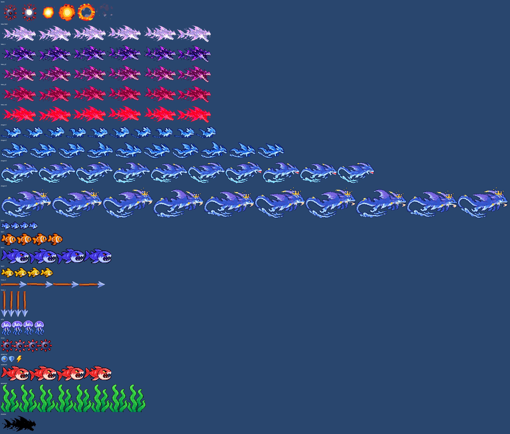

# Crest Predator Evolution

   

เกมมังกรทะเลวิวัฒนาการ เขียนด้วย **Verilog** บนบอร์ด **Digilent Nexys A7-100T** (Artix-7 XC7A100T) แสดงผลผ่าน VGA — โปรเจกต์รายวิชาของทีม (เวอร์ชันล่าสุด **v27**)

> **English:** *Crest Predator Evolution* is a Feeding Frenzy-inspired underwater evolution game written entirely in Verilog for the Nexys A7-100T FPGA board with VGA output. Eat smaller fish, evolve through 4 forms, survive hazards and mini-games, then defeat the boss. A single-file browser version is included, so you can play without a board.

## คลิปนำเสนอและ Demo

[](https://www.youtube.com/watch?v=t_mGAB2DUls)

▶ [ดูบน YouTube](https://www.youtube.com/watch?v=t_mGAB2DUls) — คลิปนำเสนอโปรเจกต์พร้อมสาธิตการเล่น (คลิปยังแสดงระบบเกมไม่ครบ ดูระบบทั้งหมดได้ที่ [AllDetails](REPORT/ALL%20DETAILS%20FullEditon(Option)/CrestPredator_AllDetails_v4%20D.pdf) และรายงาน)

## ภาพรวมเกม

ผู้เล่นเป็น "มังกรทะเล" ตัวเล็ก ว่ายในโลกใต้ทะเล กินปลาที่เล็กกว่าเพื่อเก็บ Evolution Point (EP) วิวัฒนาการผ่าน 4 ร่าง หลบอันตราย จัดการ Oxygen และหัวใจ เล่นมินิเกม event ทุก 50 วินาที เมื่อ EP ถึง 500 จะเข้าสู่การต่อสู้กับบอส — ชนะบอส = WIN พร้อมเกรด

- **4 ร่าง:** EP 25 → ร่าง 2, 75 → ร่าง 3, 200 → ร่าง 4, 500 → บอส
- **อันตราย:** ฉมวก, ทุ่นระเบิด, แมงกะพรุน, ฉลามแดง (ร่าง 2+), ฉลามยักษ์ (ซ่อนในสาหร่าย + มินิเกมสับสวิตช์)
- **Event ทุก 50 วินาที:** หลบหอก → กดลูกศร → แถบจังหวะ (วนซ้ำ)
- **บอส:** HP 12, 3 เฟส, 18 state — พุ่งชน, ฟอง, งับ, ทุ่น, สับสวิตช์, หลบหอก, ปิดท้ายด้วยมินิเกมลูกศร
- **เพลง:** 5 track แบบ 16-bit (wavetable 4 เสียง + กลอง 1 เสียง) 48,828 Hz
- **ความยาก:** EASY / NORMAL / HARD

### 4 ร่างวิวัฒนาการ

| | ร่าง 1 | ร่าง 2 | ร่าง 3 | ร่าง 4 |
|---|---|---|---|---|
| ชื่อ | Baby Dragon | Hunter Dragon | Great Ocean Dragon | King Ocean Dragon (มีมงกุฎ) |
| EP ที่ต้องใช้ | 0 | 25 | 75 | 200 (บอสที่ 500) |
| ขนาด sprite | 73×41 | 96×58 | 126×74 | 171×106 |
| ความเร็ว (px/tick) | 4.0 | 3.5 | 2.75 | 2.25 |
| กินได้ | ปลาเล็ก + ปลาทอง | + ปลากลาง | + ปลาใหญ่ | ทุกอย่าง + ทุ่น + ฉลามแดง |
| สกิล | Stealth (นิ่ง 1 วิ = ล่องหน), Bubble Breath, Small Dash | Super Dash, Dash Chain, Current Rider | Tidal Roar (ตะโกนใส่ไมค์ → สตั้นศัตรู), Tough Scales (โล่ฟื้นทุก 50 วิ) | Tidal Roar + Tough Scales, Apex Feast, Fever |

ร่างยิ่งใหญ่ ยิ่งกินได้มาก แต่ช้าลงและเป็นเป้าใหญ่ขึ้น

### ใช้ I/O บนบอร์ดอย่างไร

| อุปกรณ์ | หน้าที่ในเกม |
|---|---|
| VGA | ภาพเกม 640×480 |
| ปุ่ม 5 ปุ่ม | ว่าย / Dash / เริ่มเกม |
| สวิตช์ 16 ตัว | Pause, Mute, มินิเกมสับสวิตช์, เอียงบอร์ด, ไมโครโฟน |
| LED 16 ดวง | แถบ Oxygen (ในมินิเกม บอกว่าต้องสับสวิตช์ตัวไหน, ในบอส แสดง HP) |
| RGB LED 2 ดวง | ดวงแรกบอกสีร่าง, ดวงที่สองเตือน (แดงกะพริบ = อมตะ, เขียว = ซ่อนอยู่) |
| 7-segment 8 หลัก | ร่างและ EP, โหมดความยาก, เกรด, HP บอส |
| Audio PWM | เพลง 5 track + เสียงเอฟเฟกต์ |
| ไมโครโฟน PDM | ตะโกนเพื่อใช้ Tidal Roar |
| Accelerometer | เอียงบอร์ดบังคับทิศ, เขย่าตอนโดนบอสงับ |
| คีย์บอร์ด USB | W A S D + Space |

<details>
<summary><b>ระบบเกมที่น่าสนใจ (กดเพื่อดู)</b></summary>

- **Fever (ร่าง 4):** กินปลาครบ 14 ตัว → 8 วินาทีที่คะแนน ×2 วิ่งเร็วขึ้น และกล้องซูมออก
- **เกรด S–F:** คิดจากเวลาที่ชนะ จำนวน event ที่ผ่าน คอมโบ และโหมดความยาก (S ≥ 90, A ≥ 80, B ≥ 70, ต่ำกว่านั้น C) แพ้ตอนสู้บอสได้ D แพ้ก่อนถึงบอสได้ F
- **3 ระดับความยาก:** EASY / NORMAL / HARD ปรับจำนวนหัวใจ Oxygen ความถี่ฉมวก ทุ่น แมงกะพรุน ฉลาม power-up และบอส
- **Power-up:** หัวใจ +1 · โล่ · ความเร็ว
- **กระแสน้ำ:** ดันผู้เล่นเป็นช่วงๆ มีเส้นสายน้ำให้เห็น
- **ฉลามยักษ์:** ต้องหลบเข้าสาหร่ายและแก้มินิเกมสับสวิตช์ให้ทัน
- **รหัสลับสำหรับนักพัฒนา:** ใน PAUSE กด ↑ ↑ ↓ ↓ ← → ← → จะข้ามไปร่างถัดไป (เกรดจะกลายเป็น CHEAT)

</details>

### Sprite

sprite ทั้งหมดของเกม (มังกร 4 ร่าง ปลา บอส ศัตรู อุปสรรค power-up สาหร่าย และพื้นหลัง) อยู่ที่ [`ART_sprite_sheets/`](ART_sprite_sheets) ดูขนาดเฟรมและจำนวนเฟรมของแต่ละไฟล์ได้ใน [`manifest.json`](ART_sprite_sheets/manifest.json)

[](ART_sprite_sheets/overview_x2.png)

> เป็นภาพที่ export จากเกมเวอร์ชันคอม (สี 12 บิตเหมือนบนบอร์ด) ไม่ใช่ไฟล์ต้นฉบับของผู้ออกแบบ

## เริ่มจากตรงไหนดี

| อยากทำอะไร | ไปที่ |
|---|---|
| ดูคลิป demo | [คลิปนำเสนอและ Demo](#คลิปนำเสนอและ-demo) |
| ลองเล่นเลย (ไม่ต้องมีบอร์ด) | [เล่นบนคอม](#เล่นบนคอม) |
| รันบนบอร์ดจริง | [วิธี build](#วิธี-build) |
| ดูโค้ดทั้งหมด | [`GameSRC/`](GameSRC) |
| อ่านรายงาน / สไลด์ | [`REPORT/`](REPORT) · [`Final Presentation G15.pdf`](Final%20Presentation%20G15.pdf) |
| ดูรายละเอียดเชิงลึกทุกโมดูล | [`AllDetails v4 (PDF, 198 หน้า)`](REPORT/ALL%20DETAILS%20FullEditon(Option)/CrestPredator_AllDetails_v4%20D.pdf) |

## โครงสร้าง repository

```
Crest-Predator-Evolution/
├── GameSRC/
│   ├── cpe v27 full.zip            source code ทั้งหมดของ v27 (ต้องแตกไฟล์ก่อนใช้)
│   ├── CrestPredatorV27.html       เกมเวอร์ชันคอม
│   └── top.bit                     bitstream พร้อมโปรแกรมลงบอร์ด
├── ART_sprite_sheets/              sprite sheet ที่ export แล้ว (PNG) + ภาพรวม
├── REPORT/
│   ├── TH Version/                 รายงานภาษาไทย (.docx)
│   ├── EN Version/                 รายงานภาษาอังกฤษ (.docx)
│   └── ALL DETAILS FullEditon(Option)/   เอกสารรายละเอียดทั้งหมด (PDF)
├── STATE DIAGRAMS/                 state diagram 36 หน้า (.drawio)
├── NOTION WORKPLAN/                ตารางแผนงานจาก Notion (CSV)
├── SONG/                           เพลง 5 track (.mp3)
├── Final Presentation G15.pdf      สไลด์นำเสนอ
└── README.md
```

### ข้างใน `cpe v27 full.zip`

```
src/            76 ไฟล์ .v (78 module) + 51 ไฟล์ .mem   top.v = top module
constraints/    nexys_a7.xdc
sim/            testbench 24 ไฟล์ (tb_*.v)
tools/          Python script สร้าง ROM ภาพ ฟอนต์ แมพ บอส เพลง (tools/music16)
```

### รายละเอียดแต่ละส่วน

| ที่อยู่ | คืออะไร |
|---|---|
| [`GameSRC/cpe v27 full.zip`](GameSRC/cpe%20v27%20full.zip) | โค้ด Verilog, ROM ภาพ/เพลง (`.mem`), constraints, testbench และ script สร้างไฟล์ |
| [`GameSRC/CrestPredatorV27.html`](GameSRC/CrestPredatorV27.html) | เกมเวอร์ชันคอม — ไฟล์เดียว เปิดในเบราว์เซอร์ได้ทันที มีแผงจำลองบอร์ด (สวิตช์ LED 7-segment ปุ่ม) ใต้จอเกม |
| [`GameSRC/top.bit`](GameSRC/top.bit) | bitstream v27 สำหรับ Nexys A7-100T — โปรแกรมลงบอร์ดได้เลยโดยไม่ต้อง build เอง (Vivado 2024.2) |
| [`ART_sprite_sheets`](ART_sprite_sheets) | sprite sheet ทั้งหมดของเกม (PNG 23 ไฟล์) พร้อมภาพรวมและ manifest — ดูหัวข้อ [Sprite](#sprite) |
| [`REPORT/TH Version`](REPORT/TH%20Version) · [`REPORT/EN Version`](REPORT/EN%20Version) | รายงานโครงงานฉบับภาษาไทย (v11) และภาษาอังกฤษ (v5) |
| [`REPORT/ALL DETAILS FullEditon(Option)`](REPORT/ALL%20DETAILS%20FullEditon(Option)) | AllDetails v4: ภาค 1 ภาพรวมเกม (หัวข้อ 1–20), ภาค 2 ข้อมูลเชิงลึก — การ์ดโมดูล, ค่าคงที่, ภาพ .mem, ผังสัญญาณ top.v, testbench, ตาราง transition FSM, pipeline, เพลง, ทรัพยากร FPGA (หัวข้อ 21–31) |
| [`STATE DIAGRAMS`](STATE%20DIAGRAMS) | state diagram ทั้งหมด 36 หน้า (00 Index + 01–35) เปิดด้วย [draw.io / diagrams.net](https://app.diagrams.net) — มี 2 ไฟล์: `..._v27.drawio` และ `..._v27_clean.drawio` |
| [`NOTION WORKPLAN`](NOTION%20WORKPLAN) | ตารางแผนงานจาก Notion (หมวด / สถานะ / รายละเอียด) |
| [`SONG`](SONG) | เพลงประกอบ 5 track: Title, Play, Boss Phase 1–2, Boss Phase 3, Event Giant Shark |

## เล่นบนคอม

ดาวน์โหลด [`GameSRC/CrestPredatorV27.html`](GameSRC/CrestPredatorV27.html) แล้วดับเบิลคลิกเปิดด้วยเบราว์เซอร์ (Chrome / Edge / Firefox) — ไม่ต้องติดตั้งอะไร ไฟล์รวมภาพ เสียง และเพลงไว้ในตัว (เพลงใช้โมเดลเดียวกับบอร์ด) เสียงเริ่มเล่นหลังกดปุ่มหรือคลิกครั้งแรก

> GitHub จะแสดงไฟล์ .html เป็นโค้ด ไม่ได้รันให้ ต้องดาวน์โหลดไปเปิดเอง (กดปุ่ม **Download raw file** ที่หน้าไฟล์)

| คีย์บอร์ด | เท่ากับบนบอร์ด |
|---|---|
| ลูกศร หรือ W A S D | BTNU / BTND / BTNL / BTNR |
| Space หรือ Enter | BTNC |
| P | SW0 Pause |
| M | SW1 Mute |
| 1 2 3 4 5 6 7 8 9 0 - = | SW2–SW13 (สับสวิตช์) |
| T | SW14 เอียงบอร์ด (คอมไม่มีเซนเซอร์) |
| V | SW15 ไมโครโฟน — กด **R** ค้างแทนการตะโกน |

คลิกเมาส์ที่สวิตช์และปุ่มบนแผงจำลองบอร์ดได้ด้วย · ตอนโดนบอสงับ ให้กดปุ่มรัวแทนการเขย่าบอร์ด

## เวอร์ชันคอม (.html) ต่างจากบนบอร์ด (.bit) อย่างไร

ทั้งสองเวอร์ชันเล่นเกมเดียวกัน ตรรกะเกมและเพลงใช้โมเดลเดียวกัน แต่วิธีแสดงผลและอินพุตต่างกัน

| หัวข้อ | บอร์ด (.bit) | คอม (.html) |
|---|---|---|
| **ภาพ** | วาดด้วยวงจร Verilog ส่งออก VGA 640×480 @ 60 Hz สี 12 บิต | ใช้ sprite และพาเลตสี 12 บิตชุดเดียวกัน วาดด้วย canvas 640×480 ขนาดบนจอตามหน้าต่างเบราว์เซอร์ และมีแผงจำลองบอร์ดเพิ่มใต้จอเกม |
| **เสียง** | PWM ออกลำโพงบอร์ด สังเคราะห์สดจากวงจร | WebAudio ใช้ข้อมูลเสียงจาก `.mem` ของบอร์ด และเพลงจากโมเดลเดียวกัน เสียงเริ่มเล่นหลังคลิกครั้งแรก |
| **ปุ่ม / สวิตช์** | ปุ่มและสวิตช์จริง | คีย์บอร์ดหรือคลิกบนแผงจำลองบอร์ด |
| **เอียงบอร์ด (SW14)** | อ่าน accelerometer ADXL362 จริง | ไม่มีเซนเซอร์ ใช้ปุ่ม **T** แทน |
| **ไมโครโฟน (SW15)** | ไมค์ PDM บนบอร์ด วัดเสียงตะโกนจริง | กด **R** ค้างแทนการตะโกน |
| **เขย่าบอร์ดตอนโดนบอสงับ** | เขย่าบอร์ดหรือกดปุ่มรัว | กดปุ่มรัว |
| **สถิติ HIGH / BEST / BEST GRADE** | เก็บในวงจร หายเมื่อ reset หรือปิดบอร์ด | เก็บในเบราว์เซอร์ (localStorage) ยังอยู่หลังปิดหน้าเว็บ |
| **ความเร็ว** | game tick 60 Hz คงที่โดยฮาร์ดแวร์ | ขึ้นกับ requestAnimationFrame ของเบราว์เซอร์ |
| **LED / 7-segment / RGB LED** | ของจริงบนบอร์ด | แสดงในแผงจำลองบอร์ด |

> รายละเอียดการพอร์ตเกมจาก Verilog มา JavaScript และเครื่องมือที่เกี่ยวข้อง ดูใน **AllDetails หัวข้อ 15** (เครื่องมือ, testbench, เวอร์ชันคอม) และหัวข้อการควบคุมใน **หัวข้อ 4** — เปิดอ่านได้ที่ [`AllDetails v4 (PDF)`](REPORT/ALL%20DETAILS%20FullEditon(Option)/CrestPredator_AllDetails_v4%20D.pdf) ถ้าสนใจว่าแต่ละเวอร์ชันทำงานอย่างไรในเชิงลึก

### โปรแกรมบอร์ดโดยไม่ต้อง build เอง

ใช้ไฟล์ [`GameSRC/top.bit`](GameSRC/top.bit) (build ด้วย Vivado 2024.2, ใช้กับ Nexys A7-100T เท่านั้น)

Vivado → Open Hardware Manager → Auto Connect → Program Device → เลือกไฟล์ `.bit`

## ฮาร์ดแวร์และผล build (v27)

| หัวข้อ | ค่า |
|---|---|
| บอร์ด | Nexys A7-100T (XC7A100T-1CSG324C) |
| จอภาพ | VGA 640×480 @ 60 Hz, สี 12 บิต |
| Clock | 100 MHz → MMCM → 25 MHz (1 clock = 1 pixel), clock domain เดียว, game tick 60 Hz |
| Timing | WNS +7.567 ns |
| ทรัพยากร | LUT 49,018 · FF 7,274 · BRAM 132 / 135 (RAMB36 131 + RAMB18 2) · DSP 103 |
| เครื่องมือ | Vivado 2024.2 |
| I/O ที่ใช้ | VGA, ปุ่ม 5 + CPU_RESET, สวิตช์ 16, LED 16, RGB LED 2, 7-segment 8 หลัก, Audio PWM (mono), ไมโครโฟน PDM, Accelerometer ADXL362 (SPI), คีย์บอร์ด USB (PS/2 ผ่าน PIC24) |

## วิธี build

1. ดาวน์โหลด [`GameSRC/cpe v27 full.zip`](GameSRC/cpe%20v27%20full.zip) แล้วแตกไฟล์
2. Vivado → New Project → RTL Project → part **xc7a100tcsg324-1**
3. Add Sources: ไฟล์ทั้งหมดใน `src/` (ทั้ง `.v` และ `.mem` — รวม 127 ไฟล์) และตั้ง `top.v` เป็น top module
4. Add Constraints: `constraints/nexys_a7.xdc`
5. (ถ้าต้องการ) Add Simulation Sources: ไฟล์ใน `sim/`
6. Run Synthesis → Implementation → Generate Bitstream → Program Device

> ไฟล์ `.mem` ต้องอยู่ใน project เดียวกัน (`$readmemh`) ไม่อย่างนั้น ROM ภาพ / เพลงจะว่าง

## การควบคุม

| อินพุต | หน้าที่ |
|---|---|
| BTNU / BTND / BTNL / BTNR | ว่าย 4 ทิศ (ทแยงได้) · ที่ TITLE ซ้าย/ขวา = เลือก EASY / NORMAL / HARD · ใช้ในมินิเกม |
| BTNC | เริ่มเกม · Dash · ตอน PAUSE = เปิด/ปิดเพลง |
| CPU_RESET | reset ทั้งระบบ |
| SW0 | Pause |
| SW1 | Mute เสียงทั้งหมด |
| SW2–SW13 | มินิเกมสับสวิตช์ (LED เหนือสวิตช์กะพริบ = ต้องสับ) |
| SW14 | บังคับด้วยการเอียงบอร์ด |
| SW15 | เปิดไมโครโฟน (ตะโกน = Tidal Roar / PERFECT ROAR) |
| คีย์บอร์ด USB | W A S D + Space (คีย์บอร์ดต้องเป็นแบบ Boot HID ต่อตรง ไม่ผ่าน hub) |

รายละเอียดเต็มอยู่ในเอกสาร AllDetails หัวข้อ 4

## จุดเด่นทางเทคนิค

- **Clock เดียวทั้งระบบ:** แรกเริ่มรันที่ 100 MHz แล้ว timing ไม่ผ่าน (WNS −12 ns) จึงย้ายทั้งระบบมา 25 MHz ผ่าน MMCM (1 clock = 1 pixel) ทำให้ timing ผ่านสบาย
- **โลกกว้าง 1920×640 px** วนซ้ายขวา กล้องตามผู้เล่น พื้นหลังเก็บครึ่งความละเอียด (960×320, 256 สี) แล้วขยาย 2×2 พร้อม animation คลื่นน้ำ สาหร่ายแกว่ง และแสงเฉียง
- **ประหยัด BRAM:** sprite ใช้ palette 4 บิต (index 0 = โปร่งใส) มังกรและบอสเก็บแบบ row-span ทำให้ใช้ BRAM 132 จาก 135
- **ซ้อนภาพเป็นชั้น:** พื้นหลัง → ฟอง → ปลา/ศัตรู → ผู้เล่น → สาหร่าย → เอฟเฟกต์ → HUD/ข้อความ
- **เพลง 16-bit สังเคราะห์ในวงจร:** wavetable 4 เสียง + กลอง 5 แบบ ที่ 48,828 Hz เพลงคอมใช้โมเดลเดียวกัน
- **สร้างไฟล์ ROM ด้วย Python:** ภาพ ฟอนต์ แมพ บอส และโน้ตเพลง สร้างจาก script ใน `tools/`

> อยากรู้ลึกกว่านี้ — ทุกโมดูล (78 module) ค่าคงที่ ผังสัญญาณใน `top.v` ตาราง transition ของ FSM และ pipeline การวาดภาพ — เปิดอ่านได้ใน [AllDetails v4 (PDF)](REPORT/ALL%20DETAILS%20FullEditon(Option)/CrestPredator_AllDetails_v4%20D.pdf) ภาค 2 (หัวข้อ 21–31)

## ข้อควรรู้

- ค่าเวลา / ความเร็ว / ขนาดในโค้ดส่วนใหญ่มีป้าย `PLACEHOLDER` คือค่าที่ทีมจูนจากการเล่น
- คอมเมนต์บางจุดในโค้ดเป็นของเวอร์ชันเก่า (เช่น "pixel changes every 4 clocks") — พฤติกรรมจริงดูจากโค้ดและเอกสาร AllDetails หัวข้อ 20
- draw.io v27 หน้า 23 ยังไม่มีเส้น "ชนทุ่นตอนบอสเหลือ HP 1 → ARROW" และหน้า 35 dev_cheat เป็นแบบย่อ (โค้ดถูกต้อง)
- repo นี้มีไฟล์ใหญ่ (สไลด์ รายงาน เพลง ~75 MB) การกด **Code → Download ZIP** จะได้ไฟล์ขนาดใหญ่ ถ้าต้องการแค่โค้ดให้โหลด `GameSRC/cpe v27 full.zip` ตัวเดียว

## ทีมผู้พัฒนา

| สมาชิก | รหัสนักศึกษา | บทบาท | ความรับผิดชอบ |
|---|---|---|---|
| ภูริ เตชตรีสุคนธ์ | 68070501040 | Lead Developer / Hardware & Game Engineer | ออกแบบ game mechanics และสถาปัตยกรรมระบบ · พัฒนา Verilog ทั้งหมด 78 module พร้อม constraints (XDC) และ testbench · แปลงกราฟิกเป็น ROM (.mem) และพัฒนาเครื่องมือใน `tools/` · ออกแบบเพลงและเสียงประกอบ · synthesize และทดสอบบนบอร์ด Nexys A7-100T · พัฒนาเกมเวอร์ชันคอม (`CrestPredatorV27.html`) · วางแผนงานใน Notion · จัดทำเอกสาร AllDetails และ README |
| นิพาดา สันธนาคร | 68070501025 |  Visual & Presentation Designer | ออกแบบ sprite และ animation ของตัวละคร · จัดทำ state diagram · จัดทำสไลด์นำเสนอ |
| ทิวัตถ์ แพงสาร | 68070501069 | Visual & Presentation Designer | ออกแบบ sprite และ animation ของตัวละคร · จัดทำ state diagram · จัดทำสไลด์นำเสนอ |
| พรหมพิริยะ พงษ์สกุล | 68070501076 | Visual & Presentation Designer | ออกแบบ sprite และ animation ของตัวละคร · จัดทำ state diagram · จัดทำสไลด์นำเสนอ |
| ศักรนันท์ ศรีสวัสดิ์ | 68070501085 | Technical Writer | เรียบเรียงและจัดทำรายงานโครงงาน |

## รายวิชา

| | |
|---|---|
| รหัส / ชื่อวิชา | CPE222 Digital Electronics and Logic Design |
| อาจารย์ผู้สอน | Taweechai Nuntawisuttiwong |
| มหาวิทยาลัย | มหาวิทยาลัยเทคโนโลยีพระจอมเกล้าธนบุรี (KMUTT) |
